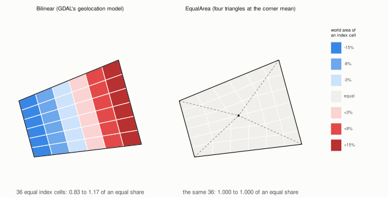
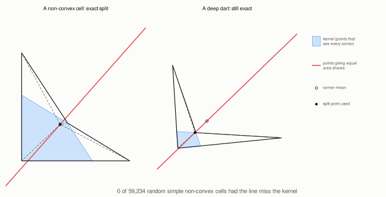
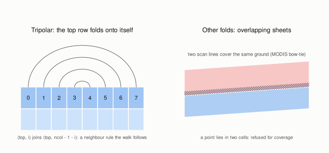
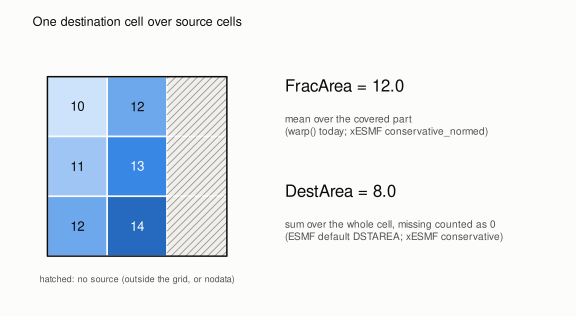
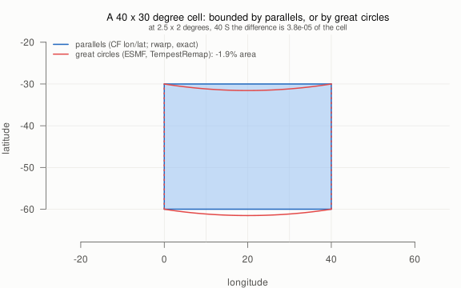

# Open decisions

Status: 2026-11-05. The decisions the roadmap is waiting on, one section
each: what is being decided, the options with their costs, the
recommendation, and what the code does today. Several are already
implemented at their recommendation *provisionally*; for those the
decision is to confirm or to change course. Each has a tracking issue
(label `decision`).

The figures are computed, not sketched: `Rscript design/figures/make-figures.R`
from the repository root regenerates them, and every number printed on a
figure comes from that script.

Sources: [curvilinear-frontend.md](curvilinear-frontend.md) ("Decisions for
the maintainer", decisions N1 to N6 here) and
[conservative.md](conservative.md) (section 10, "Open questions", C1 to C4).
C5 is recorded because it shapes how the work is presented, and is decided.

| | decision | today | recommendation |
|---|---|---|---|
| N1 | cell map default for coverage | `Bilinear` default; `burn` requires `EqualArea` | `EqualArea` for coverage |
| N2 | non-convex cells | equal-area split; fallback note never seen | keep, and test that it never fires |
| N3 | folds other than tripolar | refused at construction | refuse for coverage |
| N4 | `mesh` public or crate-private | public, documented unstable | public, unstable |
| N5 | robust predicates | plain `f64`, no snapping yet | plain `f64`, snap first |
| N6 | `f64` edge fractions in controlledburn | `f32` in `burn`, `f64` in `CoverageWindow` | `f64` in controlledburn 0.3.0 |
| C1 | weight index types | `u32` per axis | settled; confirm |
| C2 | default normalisation | `FracArea` | `FracArea`, documented |
| C3 | `warp()` built on `exact_weights` | shares the `Lattice` | settled; confirm |
| C4 | spherical measure on the destination side | source side only | wait for a use |
| C5 | cells bounded by parallels, or by great circles | parallels (exact for CF lon/lat) | decided |

---

## N1. The cell map for coverage

A curvilinear cell is the quadrilateral through its four corners. Bilinear
and equal-area maps give **the same cell**; they differ in where an interior
point of the unit square lands. Under the bilinear map (GDAL's geolocation
model) equal index areas are unequal world areas, so index-space coverage
fractions are wrong. The figure's cell is deliberately distorted (0.83 to
1.17 of an equal share). On ordinary grids the error is about 1.5% of a
cell (controlledburn-rs `examples/grid_frontends.rs`). The equal-area map
splits the cell into four triangles at the corner mean, and every index
area maps to an equal share (1.000 to 1.000).

**Today:** `CellMap::Bilinear` is the default at construction, and
`QuadMesh::burn` / `ring_to_index` require `EqualArea` (they refuse a
bilinear mesh), so coverage users must ask for it.

| option | for | against |
|---|---|---|
| **A. `EqualArea` default for coverage**, `Bilinear` for point kernels and `geo_to_pixel` (recommended) | coverage and conservative remapping are exact by default; nobody gets 1% errors by forgetting a flag | two maps of one grid in one crate; a point's index position differs from GDAL's inside a cell (never at corners or along sides) |
| B. `Bilinear` default everywhere (today) | one model, GDAL-identical everywhere; no surprise for GDAL users | coverage callers must opt in, or `burn` refuses them |
| C. `EqualArea` default everywhere | one default | point kernels lose GDAL parity; the map has kinks along the four spokes, so interpolated fields get slope breaks |

## N2. Non-convex cells

For a non-convex (but simple) cell the corner mean can lie outside the cell.
The points that give four equal-share triangles lie on a line through the
corner mean (red), and the split point must also see every corner (the
kernel, blue). The design allowed for the line missing the kernel: fall
back to the nearest kernel point, accept a slightly inexact cell, and add a
note.

**New evidence:** a random search over 59,234 simple non-convex
quadrilaterals (`design/figures/nonconvex-search.R`) found **no case**
where the line misses the kernel. It may always meet it, which would make
the fallback dead code.

| option | for | against |
|---|---|---|
| **A. Keep the split, make the fallback a debug assertion, add the search as a property test** (recommended) | turns an unknown into a test; keeps the path if a counterexample turns up | none, beyond writing the test |
| B. Accept a non-exact cell with a note (the design as written) | robust whatever the truth is | carries code for a case that may never happen |
| C. Refuse grids with such cells | simplest | refuses real grids for a case not yet seen |

A proof that the line always meets the kernel would settle it; the search
is the cheap substitute.

## N3. Folds other than tripolar

A tripolar grid (ORCA and similar) folds its top row onto itself: cell
`(top, i)` meets `(top, ncol - 1 - i)`. That is a neighbour rule, so the
walk crosses it like any side (stage 4, `Topology::Tripolar`). Other folds
are different in kind. In swaths with overlapping scan lines (the MODIS
bow-tie) two cells cover the same ground, so locating a point is ambiguous
and a walk can follow only one sheet.

**Today:** construction refuses folded (minority-sign) cells.

| option | for | against |
|---|---|---|
| **A. Refuse for coverage in the first version** (recommended) | keeps the walk single-sheet and exact; the error is explicit | swath users must cut or deduplicate scan lines first |
| B. Design for overlapping sheets now | serves raw swaths directly | location returns several cells and the walk branches; it isn't clear what "coverage" means where sheets overlap (sum, first, mean?); a lot of design for an unasked case |

## N4. Is `mesh` public?

**Today:** `rwarp::mesh` is public and documented as unstable until a
second consumer uses it.

| option | for | against |
|---|---|---|
| **A. Public, marked unstable** (today; recommended) | wxylib, the R package and others can try it now; feedback comes early | an unstable public API in a 0.x crate invites breakage reports; semver discipline gets fuzzier |
| B. Crate-private until wxylib's cover module asks | free to change; nothing to break | no outside use, so no feedback; the R bindings can't reach it |
| C. A separate crate (`rwarp-mesh`) | own version and stability promise | another crate to publish; it still needs rwarp's transformers for the exact footprint |

## N5. Robust predicates

The walk decides which triangle a segment enters next by orientation tests.
Near-degenerate input (a vertex within rounding of a side, spoke or corner)
is where plain floating point gives inconsistent answers.

**Today:** plain `f64` tests. Snapping of near-degenerate vertices isn't
implemented yet, and no property test has failed without it.

| option | for | against |
|---|---|---|
| **A. Plain `f64` with snapping first, adaptive only if tests fail** (recommended) | fast; simple; cut points are already placed by edge parameter, so shared edges agree bitwise | correctness rests on the property tests finding the bad cases |
| B. Adaptive-precision `orient2d` (Shewchuk) from the start | provably consistent orientation | slower in the hot path; a dependency (or a port) in rwarp; doesn't remove the need to place cut points consistently |

## N6. `f64` edge fractions in controlledburn

This is controlledburn's decision; it is listed here because the
curvilinear front end makes it visible. `burn`'s edge table stores
fractions as `f32`, and `CoverageWindow` is already `f64`. On a curvilinear
grid cell areas vary, so an `f32` fraction's world-area error varies by
cell.

| option | for | against |
|---|---|---|
| **A. `f64` edges in controlledburn 0.3.0** (recommended, if the C++ sibling can follow) | one precision end to end; the exact footprint can drop its `f32` rounding | output type change (0.3.0); twice the memory for the edge table; the C++/R/Python package must change in step |
| B. Keep `f32`, document it | no churn | the front end's exactness is capped at about 1e-7 of each cell |
| C. Generic over the float type | both | complexity in a crate that is dependency-free and small on purpose |

## C1. Weight index types

**Settled by implementation:** `Weights` stores `u32` row and column per
axis, as conservative.md recommended. ESMF's flattened 1-based index is
`row * ncol + col + 1`, so writers (wxylib) convert in one multiply. Grids
are limited to 4 billion cells per side. Confirm, or ask for `u64`
flattened.

## C2. Default normalisation

When a destination cell is only partly covered (the grid's edge, a
coastline, nodata), the two normalisations differ. `FracArea` averages
over what is there. `DestArea` divides by the whole cell, which counts
missing as zero.

**Today:** `Normalization::FracArea` is the default and matches `warp()`.
ESMF's default is `DSTAREA`; xESMF's `conservative` is `DSTAREA` and
`conservative_normed` is `FRACAREA`.

| option | for | against |
|---|---|---|
| **A. `FracArea` default, say so prominently** (today; recommended) | matches `warp()` and what raster users expect at coasts and edges; no artificial low values | differs from ESMF's default, so a side-by-side comparison has to set the option |
| B. `DestArea` default | matches ESMF and xESMF's `conservative` out of the box | partly covered cells come out low (8.0 rather than 12.0 in the figure), which raster users read as a bug |

## C3. `warp()` and `exact_weights`

**Settled by implementation:** `warp()`'s exact footprint and
`exact_weights` share the destination `Lattice` and its per-pixel coverage
function. `warp()` keeps its direct reduction (no weights materialised) and
its `f32` rounding for 0.2/0.3 compatibility, and a test holds the two
equal bit for bit. Confirm, or ask for one code path.

## C4. Spherical measure on the destination side

The spherical measure (stage 3a) applies on the source side, which is all
ESMF parity needs, since `frac` is relative to the source cell. A lon/lat
*destination* with a projected source would want `dst_area` on the sphere
too, for `DestArea` normalisation.

| option | for | against |
|---|---|---|
| **A. Wait for a use** (recommended) | no untested mode | `DestArea` for lon/lat destinations with projected sources stays planar in source space |
| B. Add it now | symmetry | another mode to test, with no oracle case yet |

## C5. Cells bounded by parallels, or by great circles (decided)

ESMF and TempestRemap treat every cell edge as a great circle, so a lon/lat
cell's top and bottom bow poleward: a 40 x 30 degree cell loses 1.9% of
its area, and a 2.5 x 2 degree cell at 40 S loses 3.8e-5. CF lon/lat
rasters are cells bounded by parallels, and rwarp's spherical measure is
exact for those (1e-14 against the closed form). Matching ESMF would mean
curving the *source* cells too, which is spherical polygon overlay, a
different engine.

**Decided (2026-10-29):** parallels for lon/lat rasters, with the ESMF
difference attributed and tested (`tests/esmf.rs`). Great-circle edges
come with meshes and curvilinear grids defined that way (stages 4 and 5),
through bigcurve-rs. This is the pitch: rwarp is exact for the data's own
cell definition, and can say precisely how and why it differs from ESMF.
