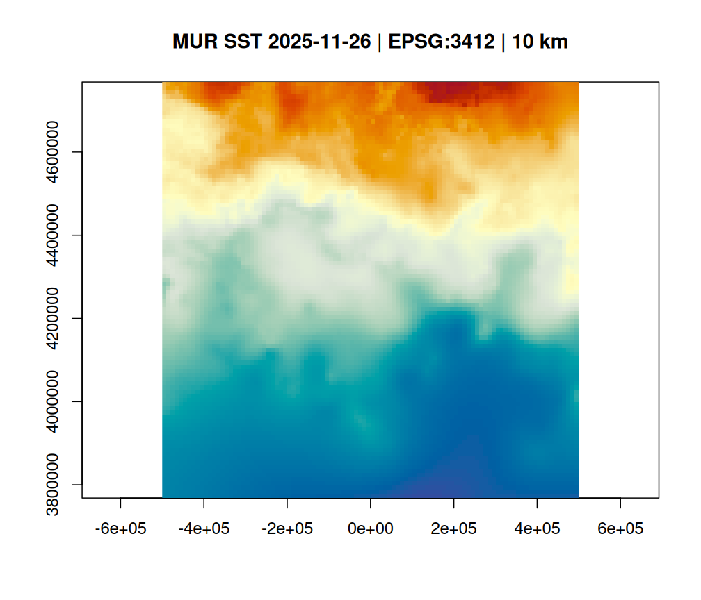

## Overview

This article reprojects a NASA GHRSST MUR v2 Sea Surface Temperature COG
from its native `EPSG:4326` (geographic) to `EPSG:3412`
(NSIDC Antarctic Polar Stereographic), covering a 1000 km x 1000 km region
centred at 52 degS / 0 degE, across the Antarctic Polar Front.

This article reads from the network (the MUR archive on Source
Cooperative), so it is precomputed: the output below was made when the
article was last knitted (see the end), not when the site was built.

It also demonstrates the **byte-ref read path**: instead of using GDAL to
read the source, we show how the same `read_fn` interface accepts a custom
reader backed by pre-harvested byte offsets.


``` r
library(rwarp)
library(gdalraster)
#> GDAL 3.14.0dev-9bb42f5a7b-dirty (released 2026-11-11), GEOS 3.12.1, PROJ 9.8.1
library(vaster)
library(reproj)
```

## Source: GHRSST MUR v2 COG


``` r
url <- paste0(
  "/vsicurl/https://data.source.coop/ausantarctic/ghrsst-mur-v2/",
  "2025/11/26/",
  "20251126090000-JPL-L4_GHRSST-SSTfnd-MUR-GLOB-v02.0-fv04.1_analysed_sst.tif"
)

ds      <- new(GDALRaster, url, read_only = TRUE)
src_crs <- ds$getProjectionRef()
src_gt  <- ds$getGeoTransform()
src_dim <- c(ds$getRasterXSize(), ds$getRasterYSize())
nodata  <- -32768L

cat("Source dimensions:", src_dim, "\n")
#> Source dimensions: 36000 17999
cat("Source pixel size:", src_gt[2], "x", abs(src_gt[6]), "degrees\n")
#> Source pixel size: 0.01 x 0.01 degrees
```

## Destination: Antarctic tile at 10 km resolution


``` r
dst_crs    <- "EPSG:3412"

## Centre of interest: 0 degE, 52 degS
center_ll  <- cbind(0, -52)
center_3412 <- reproj_xy(center_ll, target = dst_crs, source = "EPSG:4326")
cat("Center in EPSG:3412:", round(center_3412, 0), "\n")
#> Center in EPSG:3412: 0 4268271

## 1000 km x 1000 km tile, 10 km pixels -> 100 x 100 grid
tile_radius <- 500000   # metres
dst_ext <- c(
  center_3412[1] - tile_radius,
  center_3412[1] + tile_radius,
  center_3412[2] - tile_radius,
  center_3412[2] + tile_radius
)
dst_dim <- c(100L, 100L)
dst_gt  <- extent_dim_to_gt(dst_ext, dst_dim)

cat("Destination extent (EPSG:3412):", round(dst_ext), "\n")
#> Destination extent (EPSG:3412): -5e+05 5e+05 3768271 4768271
```

## Plan


``` r
plan <- warp_plan(
  src_crs  = src_crs, src_gt = src_gt, src_dim = as.integer(src_dim),
  dst_crs  = dst_crs, dst_gt = dst_gt,
  dst_off  = c(0L, 0L), dst_size = dst_dim,
  resample_padding = 1L
)

cat("Chunks:", sum(sapply(plan, length)), "\n")
#> Chunks: 1
ch <- plan[[1]][[1]]
cat(sprintf("Source window: [%d, %d] + %d x %d  (fill = %.3f)\n",
  ch$src_xoff, ch$src_yoff, ch$src_xsize, ch$src_ysize, ch$fill_ratio))
#> Source window: [17242, 13768] + 1515 x 852  (fill = 1.002)
```

## Execute with a GDAL reader


``` r
read_gdal <- function(xoff, yoff, xsize, ysize) {
  as.integer(
    ds$read(1L, xoff = xoff, yoff = yoff,
            xsize = xsize, ysize = ysize,
            out_xsize = xsize, out_ysize = ysize)
  )
}

result_gdal <- warp_exec(
  plan      = plan,
  read_fn   = read_gdal,
  src_crs   = src_crs, src_gt = src_gt,
  dst_crs   = dst_crs, dst_gt = dst_gt,
  dst_size  = dst_dim,
  src_nodata = nodata, dst_nodata = nodata
)

## Scale factor: MUR SST is stored as int16, scale 0.001 + offset 298.15 -> Celsius
sst_celsius <- (result_gdal * 0.001 + 298.15) - 273.15
sst_celsius[result_gdal == nodata] <- NA

cat("SST range (Celsius):", round(range(sst_celsius, na.rm = TRUE), 2), "\n")
#> SST range (Celsius): -1.59 5.97
```

## Visualise


``` r
if (requireNamespace("ximage", quietly = TRUE)) {
  ximage::ximage(
    sst_celsius, dst_ext,
    main = "MUR SST 2025-11-26 | EPSG:3412 | 10 km",
    col  = rev(hcl.colors(256, "RdYlBu")),
    zlim = range(sst_celsius, na.rm = TRUE), asp = 1
  )
}
```



``` r
ds$close()
```

## The byte-ref read path (conceptual)

The plan/execute split is designed so that `read_fn` is entirely swappable.
When you have pre-harvested byte offsets for a COG (e.g. from
`rustycogs::tiff_refs()`), you can substitute a byte-ref reader without
changing any other code:


``` r
## Suppose `refs` is a data.frame with columns:
##   path, offset, length, tile_col, tile_row, tile_w, tile_h, dtype
## and `raw_read(path, offset, length)` fetches raw bytes (HTTP range request).

## A byte-ref reader for the same GHRSST source
read_byteref <- function(xoff, yoff, xsize, ysize) {
  ## Which tiles overlap this window?
  tc_range <- c(xoff, xoff + xsize - 1L) %/% 512L
  tr_range <- c(yoff, yoff + ysize - 1L) %/% 512L

  buf <- matrix(nodata, nrow = ysize, ncol = xsize)
  for (tc in tc_range[1]:tc_range[2]) {
    for (tr in tr_range[1]:tr_range[2]) {
      ref <- refs[refs$tile_col == tc & refs$tile_row == tr, ]
      if (nrow(ref) == 0L) next
      raw <- raw_read(ref$path, ref$offset, ref$length)
      tile <- decompress_int16(raw)   # user-supplied decompressor
      ## Place tile into buf ...
    }
  }
  as.integer(as.vector(t(buf)))
}

## The plan and execute calls are *identical* to the GDAL path:
result_byteref <- warp_exec(
  plan, read_byteref, src_crs, src_gt, dst_crs, dst_gt, dst_dim, nodata = nodata
)
```

This is the key architectural property of rwarp: the warp kernel and the data
source are fully decoupled.


## Built with

Knitted on 2026-11-16 with the rwarp R package
0.1.0.9000, reading through gdalraster
2.7.0.9004 (GDAL 3.14.0dev-9bb42f5a7b-dirty).
